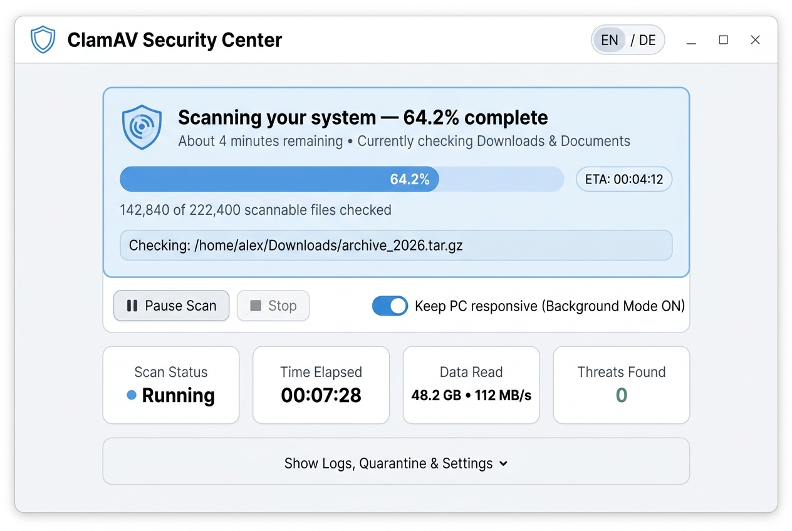
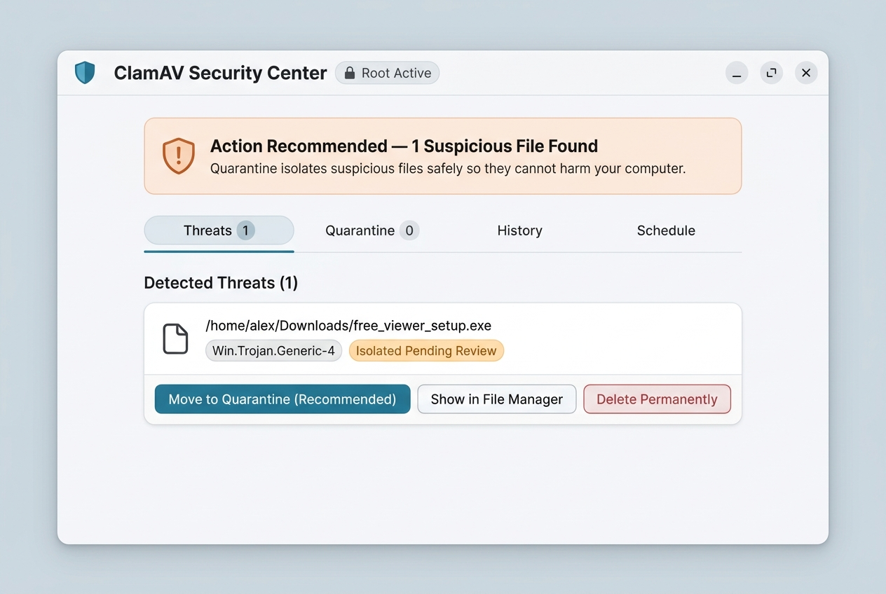
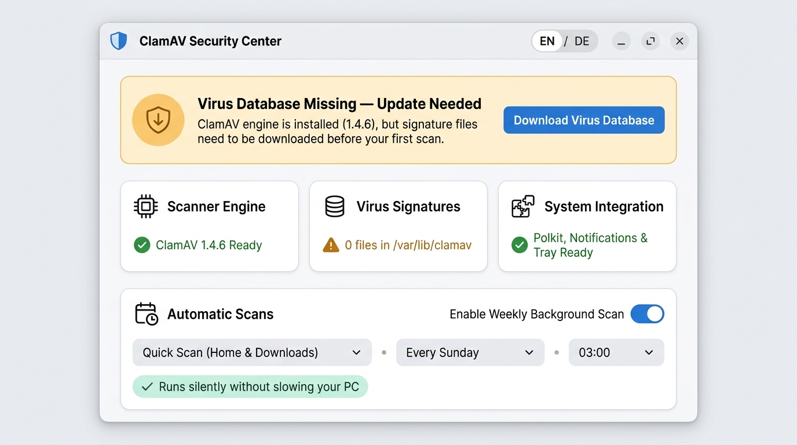

# ClamAV Security Center

Open-source Qt6 desktop control center for Linux to launch, monitor, pause/resume, cancel, and schedule **ClamAV** antivirus scans, inspect real-time file/I/O progress telemetry, manage quarantined files, and keep virus signatures up to date across **KDE Plasma** and **GNOME**.

> **Creator:** Armin Schneider ([@JXS1985](https://github.com/JXS1985))  
> **Repository:** <https://github.com/JXS1985/ClamAV-GUI>  
> **License:** [GNU General Public License v3.0 (GPL-3.0)](LICENSE)

---

## Screenshots

| Protected Home | Active Scan Telemetry |
| :---: | :---: |
|  |  |

| Threat Resolution | Health & Schedule |
| :---: | :---: |
|  |  |

---

## Features

- **One-Click Scan Modes:** Quick Scan (`Downloads`, `Home`), Full System Scan (`/` with virtual filesystem exclusions), and direct Folder/File Browser picker or Drag & Drop.
- **Live `/proc` & FD Telemetry:** Real-time percentage, ETA calculation (blended average + live speed + background file pre-counting), currently inspected file path, I/O throughput, and CPU/RAM usage.
- **Full Job Control:** Pause (`SIGSTOP`), resume (`SIGCONT`), cleanly cancel (`SIGTERM`/`SIGKILL` with immediate UI/timer reset), and toggle background low-priority mode (`renice`/`ionice`).
- **4 Organized Expert Tabs (Expandable on Demand):**
  - **Live Log & History:** Streamed scan log with live filtering plus merged CLI/GUI scan summary history.
  - **Threats (N) & Quarantine (M):** Reveal infected files in Dolphin/Nautilus, securely quarantine with collision-safe manifests, restore (original path or custom folder), or permanently delete.
  - **Schedule & Custom Scan:** Configure `systemd` service + persistent timers (daily/weekly, background mode) and launch customized `clamscan` runs with exclusions, PUA detection, archive inspection, and command preview.
  - **Virus Database:** Check signature status and trigger `freshclam` updates from the UI.
- **Privilege Separation Architecture:** Unprivileged Qt6 GUI (`PySide6` with `PyQt6` fallback) communicates over newline-delimited JSON-RPC (`stdin`/`stdout`) with a root-elevated `--helper` process via `pkexec` (Polkit) or `sudo`.
- **Cross-Desktop & 8-Language Localization:** Adapts to **KDE Plasma** (`Dolphin`, `QSystemTrayIcon`, Breeze icons) and **GNOME** (`Nautilus`, `notify-send` + Adwaita portal integration), and automatically matches OS locale across **English, German, Spanish, French, Portuguese, Chinese, Japanese, and Russian**.
- **In-App About Dialog:** Accessible from the top-right **About** button and system tray menu with version, creator info, GPL-3.0 license, and clickable GitHub link.

---

## Security Architecture

Code crossing the unprivileged GUI / privileged `--helper` boundary enforces strict defensive hardening:
- Root-owned executable checks and `clamscan` argument allowlisting (no arbitrary flags or `shell=True`).
- Path-traversal prevention, symlink-ancestor refusal (`O_NOFOLLOW` / `O_DIRECTORY`), and protected system directory guards before quarantine/delete/restore operations.
- Root log confinement to `/var/log/` and root quarantine confinement to `/root/quarantine`.
- Verified `clamscan` PID ownership checks before signaling or priority changes, strictly scoped Polkit rules (`subject.active && subject.local`), and plain-text Qt rendering for all untrusted file paths and log lines.

---

## Running from Source

### Prerequisites

- Python `>= 3.10`
- Qt6 Python bindings: `PySide6` (or `PyQt6`)
- `clamav`, `clamav-freshclam`, `polkit`, `findutils`, `procps`, `libnotify` (`notify-send`)

### Launch

```bash
chmod +x run.sh clamav_gui.py
./run.sh
```

Options:

```bash
./run.sh --lang de       # Force a specific UI language (en, de, es, fr, pt, zh, ja, ru)
./run.sh --self-test     # Run built-in diagnostics & JSON-RPC helper checks
```

### Windows Support

ClamAV Security Center also runs natively on Windows (from source via `run_windows.bat` or as the standalone `ClamAV-Security-Center-Windows-x64.zip` PyInstaller bundle from GitHub Releases) and smooths over ClamAV's manual Windows setup:

- **Automatic ClamAV Discovery**: Finds `clamscan.exe`, `freshclam.exe`, and signature databases automatically across standard Windows install paths (`Program Files\ClamAV`, `ProgramData\clamav`, Scoop, Chocolatey, `winget`, or `PATH`).
- **Zero-Config Signature Updates (`freshclam`)**: Automatically generates and maintains a working `freshclam.conf` in `%LOCALAPPDATA%\clamav-kde-gui\freshclam.conf` (removing the upstream `Example` blocker line and configuring a user-writable database directory under `%LOCALAPPDATA%\clamav-kde-gui\database`) so updating signatures works without editing config files or requiring admin rights.
- **Native Windows Controls**: Uses a local helper process (no `sudo`/`pkexec`), Win32 thread suspend/resume and process priority/I/O telemetry, pure-Python scan precounting, `explorer.exe /select` file reveal, and Windows Task Scheduler (`schtasks`) for scheduled scans.

```bat
pip install PySide6
run_windows.bat
```

---

## Building Native Packages (`.deb` / `.rpm`)

Use [`packaging/build_packages.sh`](packaging/build_packages.sh):

```bash
# Debian / Ubuntu / Kubuntu (.deb)
./packaging/build_packages.sh --type deb --version 1.0.0 --release 1

# Fedora / Rocky Linux (.rpm)
./packaging/build_packages.sh --type rpm --rpm-flavor fedora --dist-tag fc45 --version 1.0.0 --release 1

# openSUSE Leap / Tumbleweed (.rpm)
./packaging/build_packages.sh --type rpm --rpm-flavor opensuse --dist-tag tw --version 1.0.0 --release 1
```

Automated GitHub Actions CI (`.github/workflows/ci.yml`) tests across openSUSE Leap 16 / 16.1 / Tumbleweed, Rocky Linux 10, Fedora 45, Ubuntu 26.04 (GNOME), and Kubuntu 26.04 (KDE), and pushing a `v*` tag triggers `.github/workflows/build-packages.yml` to build and attach `.deb`/`.rpm` assets and `SHA256SUMS` to the GitHub Release.

---

## Running Tests

```bash
QT_QPA_PLATFORM=offscreen python3 -m unittest discover -s . -p "test_*.py" -v
QT_QPA_PLATFORM=offscreen python3 clamav_gui.py --self-test
python3 -m py_compile clamav_gui.py test_clamav_gui.py test_ui_clamav_gui.py packaging/verify_installed_os.py
bash -n run.sh packaging/build_packages.sh
```

---

## License

Copyright (C) 2026 **Armin Schneider** ([@JXS1985](https://github.com/JXS1985)).  
Licensed under the **GNU General Public License v3.0** — see [LICENSE](LICENSE) for full terms.
