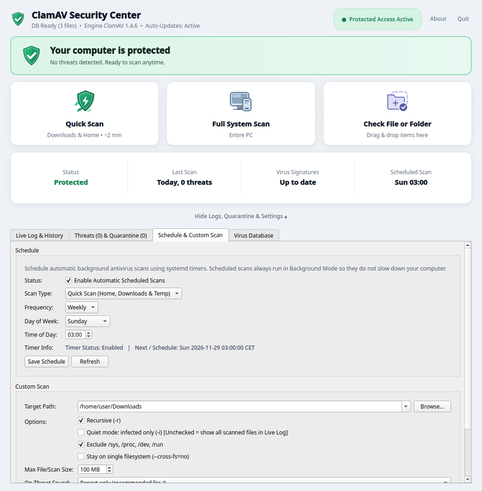

# ClamAV Security Center

Open-source cross-platform Qt6 desktop control center for **Linux** (KDE Plasma & GNOME), **Windows** (10/11), and **macOS** (Apple Silicon & Intel) to launch, monitor, pause/resume, cancel, and schedule **ClamAV** antivirus scans, inspect real-time progress telemetry, manage quarantined files, and keep virus signatures up to date.

> **Creator:** Armin Schneider ([@JXS1985](https://github.com/JXS1985))  
> **Repository:** <https://github.com/JXS1985/ClamAV-GUI>  
> **License:** [GNU General Public License v3.0 (GPL-3.0)](LICENSE)

---

## Screenshots

| Protected Home | Active Scan & Live Log |
| :---: | :---: |
|  |  |

| Threats & Quarantine | Schedule & Custom Scan |
| :---: | :---: |
|  |  |

---

## Installation

Pre-built packages and archives are attached to every tag release on the [GitHub Releases](https://github.com/JXS1985/ClamAV-GUI/releases) page (`.deb`, `.rpm`, Arch `.pkg.tar.zst`, `ClamAV-Security-Center-Windows-x64.zip`, and `ClamAV-Security-Center-macOS.zip`), or you can run directly from source.

### Linux (KDE Plasma & GNOME)

#### Option A: Native `.deb` / `.rpm` / Arch `.pkg.tar.zst` Package (from GitHub Releases)

```bash
# Ubuntu / Debian / Kubuntu
sudo apt update && sudo apt install ./clamav-security-center_*.deb

# Fedora / Rocky Linux / RHEL
sudo dnf install ./clamav-security-center-*.rpm

# openSUSE Leap / Tumbleweed
sudo zypper install ./clamav-security-center-*.rpm

# Arch Linux (KDE Plasma & GNOME)
sudo pacman -U ./clamav-security-center-*.pkg.tar.zst
```

After installation, launch **ClamAV Security Center** from your application menu or run `clamav-security-center` in a terminal.

#### Option B: Run from Source on Linux

Install Python `>= 3.10`, Qt6 bindings (`PySide6` or `PyQt6`), and ClamAV:

```bash
# Debian / Ubuntu / Kubuntu
sudo apt install python3 python3-pyside6.qtwidgets python3-pyside6.qtsvg python3-pyside6.qtcore clamav clamav-freshclam policykit-1 findutils procps libnotify-bin

# Fedora / Rocky Linux
sudo dnf install python3 python3-pyside6 clamav clamav-freshclam polkit findutils procps-ng libnotify

# openSUSE Leap / Tumbleweed
sudo zypper install python3-qt6 clamav polkit findutils procps libnotify-tools

# Arch Linux (KDE Plasma & GNOME)
sudo pacman -S python pyside6 clamav polkit findutils procps-ng libnotify
```

Clone and launch:

```bash
git clone https://github.com/JXS1985/ClamAV-GUI.git
cd ClamAV-GUI
chmod +x run.sh clamav_gui.py
./run.sh
```

---

### Windows (Windows 10 / 11)

1. **Install ClamAV**:

   ```powershell
   # Chocolatey
   choco install clamav -y

   # or Winget
   winget install Cisco.ClamAV
   ```

   *(Standard MSI installers under `Program Files\ClamAV`, `ProgramData\ClamAV`, `C:\ClamAV`, `%LOCALAPPDATA%\Programs\ClamAV`, and Chocolatey are detected automatically.)*

2. **Install & Launch ClamAV Security Center**:
   - **Option A — Standalone Bundle:** Download and extract `ClamAV-Security-Center-Windows-x64.zip` from [GitHub Releases](https://github.com/JXS1985/ClamAV-GUI/releases), then double-click `clamav-security-center.exe`.
   - **Option B — From Source:**
     ```bat
     git clone https://github.com/JXS1985/ClamAV-GUI.git
     cd ClamAV-GUI
     pip install PySide6
     run_windows.bat
     ```

**Zero-Config Windows Setup:** ClamAV Security Center automatically discovers `clamscan.exe` and `freshclam.exe`, generates a working `freshclam.conf` in `%LOCALAPPDATA%\clamav-kde-gui\freshclam.conf` (disabling the upstream `Example` blocker line), creates `%LOCALAPPDATA%\clamav-kde-gui\database`, and passes `--database=` when scanning so you don't need to hand-edit `.conf` files or run as Administrator for normal scans.

---

### macOS (Apple Silicon & Intel)

1. **Install ClamAV via Homebrew**:

   ```bash
   brew install clamav
   ```

   *(Checks `/opt/homebrew`, `/usr/local`, `/opt/local`, and `~/Library/Application Support/clamav-kde-gui` automatically.)*

2. **Install & Launch ClamAV Security Center**:
   - **Option A — Standalone App Bundle:** Download and unzip `ClamAV-Security-Center-macOS.zip` from [GitHub Releases](https://github.com/JXS1985/ClamAV-GUI/releases), then open `ClamAV Security Center.app`.
   - **Option B — From Source:**
     ```bash
     git clone https://github.com/JXS1985/ClamAV-GUI.git
     cd ClamAV-GUI
     pip3 install PySide6
     python3 clamav_gui.py
     ```

---

## How to Use

### 1. Access Modes (Root vs. Unprivileged User Mode vs. Local Helper)

- **Windows & macOS:** Connects its local `--helper` process automatically (`Protected Access Active`) with no Polkit or `sudo` prompt required.
- **Linux — Protected Root Mode:** Click **Unlock Password...** (`sudo`) or **Unlock via Polkit** (`pkexec`) to authorize the current helper session. This permits system-wide scans, shared signature updates, and system `systemd` timers. Quarantine and deletion through a delegated helper are limited to files owned by the invoking user. For findings owned by other users, review the results with your system administrator.
- **Linux — Unprivileged User Mode (No Root Required):** If your account does not have `sudo`/Polkit access, click **User Mode** in the top banner (or **Continue in User Mode** when prompted). In **User Mode Active**:
  - Scans, live telemetry (`/proc/<pid>/io`, `/proc/<pid>/fd` for your own `clamscan` process), ETA, and Pause/Resume/Stop work normally on all files your user can read.
  - Scan logs (`clamav-scan.log`), isolated threats (`quarantine/`), user `freshclam.conf`, and downloaded signatures (`database/`) are stored in `~/.local/share/clamav-kde-gui/`.
  - Scheduled scans use `systemctl --user` units in `~/.config/systemd/user/`.

### 2. Updating Virus Signatures (`freshclam`)

Before your first scan (or if the banner reports a missing virus database):

1. Click **Show Logs, Quarantine & Settings ▾** (or click the **Update Virus Database** button in the yellow banner).
2. Open the **Virus Database** tab and click **Update Signatures Now (`freshclam`)**.
3. On **Windows**, **macOS**, and **Linux User Mode**, ClamAV Security Center automatically configures `freshclam.conf` and a writable signature folder without manual editing. On **Linux Root Mode**, it temporarily stops any conflicting `freshclam` service unit and restarts it afterward.

### 3. Running & Controlling Scans

From the Home view, launch any scan with one click:

- **Quick Scan:** Scans existing user folders (`Downloads`, `Desktop` / `Schreibtisch`, `Documents` / `Dokumente`, and `/tmp`).
- **Full System Scan:** Scans `/` (excluding Linux virtual filesystems `/sys`, `/proc`, `/dev`, `/run`) or `C:\` on Windows.
- **Check File or Folder:** Opens the native file/folder picker directly so you can select one or more files or directories, or **drag & drop** files/folders anywhere onto the window.

While a scan runs, the **Active Scan Progress & Controls** panel expands to show:

- **Live Progress Bar & ETA:** Combines disk usage estimation (`statvfs` / `disk_usage`), background file pre-counting, live I/O byte throughput (Linux `/proc/io` or Win32 `GetProcessIoCounters`), and currently inspected file (`/proc/<pid>/fd` on Linux, `lsof` on macOS).
- **Job Controls:** **Pause Scan** / **Resume Scan**, **Stop Scan**, and **Background Mode** (`renice 19` + `ionice -c 3` / Windows idle priority) so desktop apps stay responsive.
- **Restart Scan Without `-i`:** When watching an external scan launched with `-i` (`--infected`), click this button to relaunch without `-i` and stream every scanned file into **Live Log**.

### 4. Resolving Threats & Managing Quarantine

Expand **Logs, Quarantine & Settings** and open the **Threats & Quarantine** tab:

- **Threats:** Select a detected file to **Reveal in File Manager** (Dolphin, Nautilus, Windows Explorer `explorer.exe /select`, or macOS Finder `open -R`), **Copy Path**, **Move to Quarantine**, or **Delete File**.
- **Quarantine:** On POSIX, samples are stored with mode `0600` and their original permissions are recorded in `manifest.json`. Restore preserves ordinary permission bits, with mode `0600` as the fallback for legacy items. For delegated Linux restores, choose an existing writable folder you own.

### 5. Scheduling Automatic Scans & Custom Scans

Open the **Schedule & Custom Scan** tab:

- **Automatic Schedules:** Enable daily or weekly scheduled background scans (`Quick` or `Full`), pick the day and time, and click **Save Schedule**. Uses `systemd` system timers (Linux root), `systemd --user` timers (Linux User Mode), Windows Task Scheduler `schtasks` (`%LOCALAPPDATA%\clamav-kde-gui\scheduled-scan.cmd`), or macOS `launchd` LaunchAgents (`~/Library/LaunchAgents`).
- **Custom Scan Builder:** Choose a target path, adjust scan limits and exclusions, and inspect the command preview. Delegated Linux scans use **Report only**. The Threats tab offers quarantine and deletion after review.

### 6. Starting the App at Login

Open **Settings** and enable **Launch minimized at login**. This option is off by default and applies to your user account on Linux, macOS, and Windows. At your next login, restore the app from the taskbar or Dock. Opening the app yourself still shows the main window normally.

Put the macOS app in Applications or the portable Windows executable in its permanent folder before enabling the option. If you move the app afterward, turn the option off and back on to update its location.

---

## CLI Options

```bash
./run.sh --lang de       # Force UI language (en, de, es, fr, pt, zh, ja, ru)
./run.sh --start-minimized  # Open the window minimized for this launch
./run.sh --self-test     # Run built-in diagnostics & JSON-RPC helper checks
./run.sh --helper        # Run headless JSON-RPC helper mode
```

*(OS locale is detected automatically across English, German, Spanish, French, Portuguese, Chinese, Japanese, and Russian.)*

---

## Security Architecture

The Qt application communicates with its helper over standard input and output. The wire protocol, Win32 process controls, and POSIX process and file operations live in the Qt-independent `clamav_backend` package.

Code crossing the GUI / `--helper` JSON-RPC (`stdin`/`stdout`) boundary enforces strict hardening:
- Root-owned executable checks on Linux and `clamscan` / `clamscan.exe` argument allowlisting (no arbitrary flags or `shell=True`).
- Path-traversal prevention, symlink-ancestor refusal (`O_NOFOLLOW` / `O_DIRECTORY`), and protected system directory guards before quarantine/delete/restore operations.
- Root log confinement to `/var/log/` and root quarantine confinement to `/root/quarantine` when running as Linux root, with safe remapping to user data directories in unprivileged User Mode.
- Verified `clamscan` PID ownership checks before signaling or priority changes, per-session sudo or Polkit authorization, and plain-text Qt rendering for untrusted file paths and logs. The legacy passwordless helper command is rejected and the app uses a fresh elevation command.

---

## Building Native Packages (`.deb` / `.rpm` / Arch `.pkg.tar.zst`)

Use [`packaging/build_packages.sh`](packaging/build_packages.sh) (or [`packaging/PKGBUILD`](packaging/PKGBUILD) on Arch Linux):

```bash
# Debian / Ubuntu / Kubuntu (.deb)
./packaging/build_packages.sh --type deb --version 1.0.0 --release 1

# Fedora / Rocky Linux (.rpm)
./packaging/build_packages.sh --type rpm --rpm-flavor fedora --dist-tag fc45 --version 1.0.0 --release 1

# openSUSE Leap / Tumbleweed (.rpm)
./packaging/build_packages.sh --type rpm --rpm-flavor opensuse --dist-tag tw --version 1.0.0 --release 1

# Arch Linux (.pkg.tar.zst)
./packaging/build_packages.sh --type arch --version 1.0.0 --release 1
```

GitHub Actions CI (`.github/workflows/ci.yml`, manual `workflow_dispatch`, max 2 runners in parallel) runs the backend and headless Qt suites on **Arch Linux**, **openSUSE Leap 16 / 16.1 / Tumbleweed**, **Rocky Linux 10**, **Fedora 45**, **Ubuntu 26.04 (GNOME)**, **Kubuntu 26.04 (KDE)**, **Windows**, and **macOS**. The live UI test runs the native `clamscan` with a local test signature and checks detection, quarantine, and restore through the helper. Linux verifies the installed native package and desktop entry. Windows and macOS build and run the packaged `--self-test`. The manual packaging workflow (`.github/workflows/build-packages.yml`) builds `.deb`, Arch `.pkg.tar.zst`, `.rpm`, Windows `.zip`, and macOS `.zip` packages.

---

## Running Tests

```bash
QT_QPA_PLATFORM=offscreen python3 -m unittest discover -s tests -v
QT_QPA_PLATFORM=offscreen python3 clamav_gui.py --self-test
python3 -m compileall -q clamav_gui.py clamav_backend tests packaging/verify_installed_os.py
bash -n run.sh && bash -n packaging/build_packages.sh && bash -n packaging/PKGBUILD
```

Set `CLAMAV_GUI_LIVE_TEST=1` to include the live scan and quarantine test. Run it as a regular user with ClamAV installed. The test creates its own temporary signature database and sample files.

---

## License

Copyright (C) 2026 **Armin Schneider** ([@JXS1985](https://github.com/JXS1985)).  
Licensed under the **GNU General Public License v3.0** — see [LICENSE](LICENSE) for full terms.
