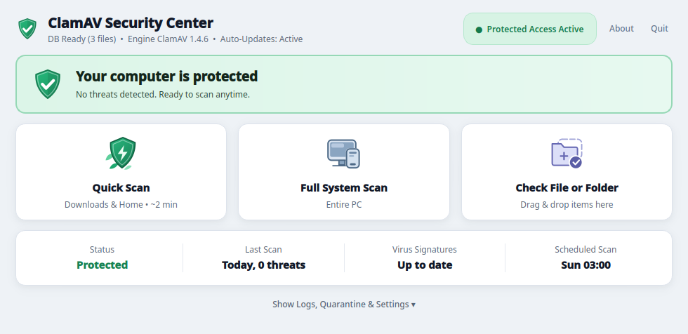
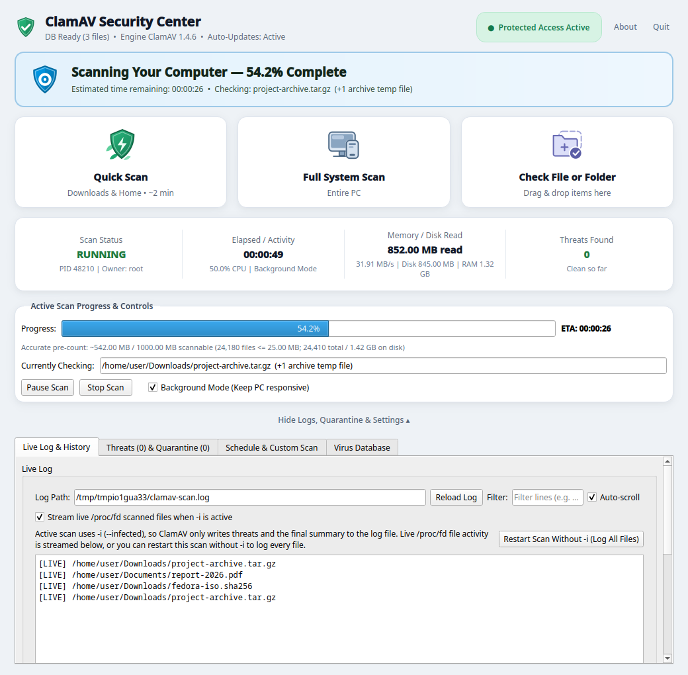
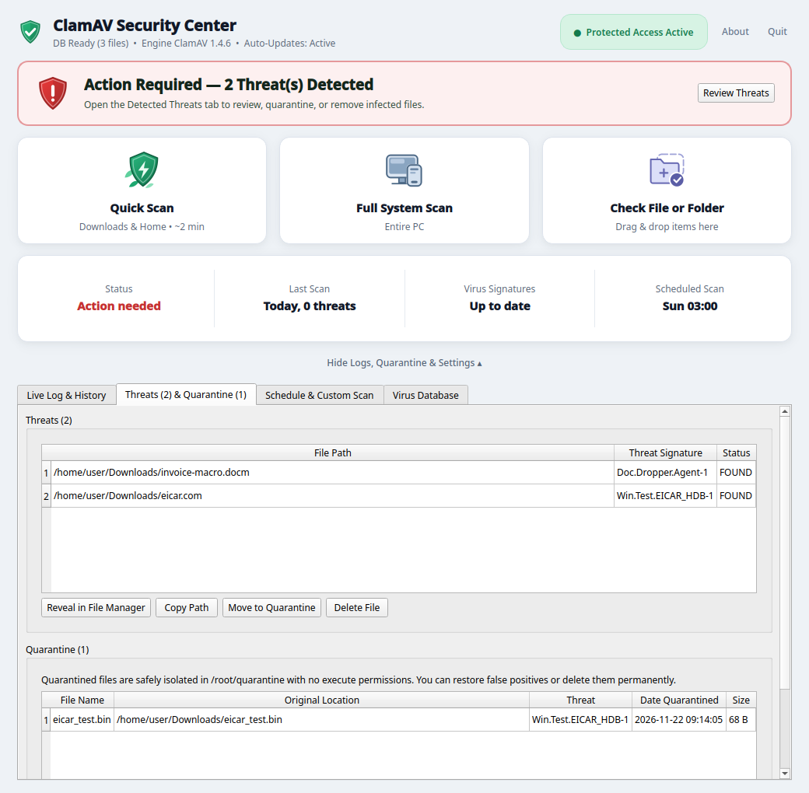

# ClamAV Security Center

Open-source cross-platform Qt6 desktop control center for **Linux** (KDE Plasma & GNOME), **Windows** (10/11), and **macOS** (Apple Silicon & Intel) to launch, monitor, pause/resume, cancel, and schedule **ClamAV** antivirus scans, inspect real-time progress telemetry, manage quarantined files, and keep virus signatures up to date.

> **Creator:** Armin Schneider ([@JXS1985](https://github.com/JXS1985))  
> **Repository:** <https://github.com/JXS1985/ClamAV-GUI>  
> **License:** [GNU General Public License v3.0 (GPL-3.0)](LICENSE)

---

## Screenshots

| Protected Home | Active Scan & Live Log |
| :---: | :---: |
|  |  |

| Threats & Quarantine | Schedule & Custom Scan |
| :---: | :---: |
|  |  |

---

## Installation

Pre-built packages and archives are attached to every tag release on the [GitHub Releases](https://github.com/JXS1985/ClamAV-GUI/releases) page (`.deb`, `.rpm`, `ClamAV-Security-Center-Windows-x64.zip`, and `ClamAV-Security-Center-macOS.zip`), or you can run directly from source.

### Linux (KDE Plasma & GNOME)

#### Option A: Native `.deb` / `.rpm` Package (from GitHub Releases)

```bash
# Ubuntu / Debian / Kubuntu
sudo apt update && sudo apt install ./clamav-security-center_*.deb

# Fedora / Rocky Linux / RHEL
sudo dnf install ./clamav-security-center-*.rpm

# openSUSE Leap / Tumbleweed
sudo zypper install ./clamav-security-center-*.rpm
```

After installation, launch **ClamAV Security Center** from your application menu or run `clamav-security-center` in a terminal.

#### Option B: Run from Source on Linux

Install Python `>= 3.10`, Qt6 bindings (`PySide6` or `PyQt6`), and ClamAV:

```bash
# Debian / Ubuntu / Kubuntu
sudo apt install python3 python3-pyside6.qtwidgets python3-pyside6.qtsvg python3-pyside6.qtcore clamav clamav-freshclam policykit-1 findutils procps libnotify-bin

# Fedora / Rocky Linux
sudo dnf install python3 python3-pyside6 clamav clamav-freshclam polkit findutils procps-ng libnotify

# openSUSE Leap / Tumbleweed
sudo zypper install python3-qt6 clamav polkit findutils procps libnotify-tools
```

Clone and launch:

```bash
git clone https://github.com/JXS1985/ClamAV-GUI.git
cd ClamAV-GUI
chmod +x run.sh clamav_gui.py
./run.sh
```

---

### Windows (Windows 10 / 11)

1. **Install ClamAV**:

   ```powershell
   # Chocolatey
   choco install clamav -y

   # or Winget
   winget install Cisco.ClamAV
   ```

   *(Standard MSI installers under `Program Files\ClamAV`, `ProgramData\ClamAV`, `C:\ClamAV`, `%LOCALAPPDATA%\Programs\ClamAV`, and Chocolatey are detected automatically.)*

2. **Install & Launch ClamAV Security Center**:
   - **Option A — Standalone Bundle:** Download and extract `ClamAV-Security-Center-Windows-x64.zip` from [GitHub Releases](https://github.com/JXS1985/ClamAV-GUI/releases), then double-click `clamav-security-center.exe`.
   - **Option B — From Source:**
     ```bat
     git clone https://github.com/JXS1985/ClamAV-GUI.git
     cd ClamAV-GUI
     pip install PySide6
     run_windows.bat
     ```

**Zero-Config Windows Setup:** ClamAV Security Center automatically discovers `clamscan.exe` and `freshclam.exe`, generates a working `freshclam.conf` in `%LOCALAPPDATA%\clamav-kde-gui\freshclam.conf` (disabling the upstream `Example` blocker line), creates `%LOCALAPPDATA%\clamav-kde-gui\database`, and passes `--database=` when scanning so you don't need to hand-edit `.conf` files or run as Administrator for normal scans.

---

### macOS (Apple Silicon & Intel)

1. **Install ClamAV via Homebrew**:

   ```bash
   brew install clamav
   ```

   *(Checks `/opt/homebrew`, `/usr/local`, `/opt/local`, and `~/Library/Application Support/clamav-kde-gui` automatically.)*

2. **Install & Launch ClamAV Security Center**:
   - **Option A — Standalone App Bundle:** Download and unzip `ClamAV-Security-Center-macOS.zip` from [GitHub Releases](https://github.com/JXS1985/ClamAV-GUI/releases), then open `ClamAV Security Center.app`.
   - **Option B — From Source:**
     ```bash
     git clone https://github.com/JXS1985/ClamAV-GUI.git
     cd ClamAV-GUI
     pip3 install PySide6
     python3 clamav_gui.py
     ```

---

## How to Use

### 1. Access Modes (Root vs. Unprivileged User Mode vs. Local Helper)

- **Windows & macOS:** Connects its local `--helper` process automatically (`Protected Access Active`) with no Polkit or `sudo` prompt required.
- **Linux — Protected Root Mode:** Click **Unlock Password...** (`sudo`) or **Unlock via Polkit** (`pkexec`) in the top banner to run system-wide scans (`/`), read `/var/log/clamav-scan.log`, quarantine root-owned files in `/root/quarantine`, update `/var/lib/clamav` via `freshclam`, and manage system `systemd` timers. Upon unlock, it installs a tightly scoped Polkit rule for seamless future launches.
- **Linux — Unprivileged User Mode (No Root Required):** If your account does not have `sudo`/Polkit access, click **User Mode** in the top banner (or **Continue in User Mode** when prompted). In **User Mode Active**:
  - Scans, live telemetry (`/proc/<pid>/io`, `/proc/<pid>/fd` for your own `clamscan` process), ETA, and Pause/Resume/Stop work normally on all files your user can read.
  - Scan logs (`clamav-scan.log`), isolated threats (`quarantine/`), user `freshclam.conf`, and downloaded signatures (`database/`) are stored in `~/.local/share/clamav-kde-gui/`.
  - Scheduled scans use `systemctl --user` units in `~/.config/systemd/user/`.

### 2. Updating Virus Signatures (`freshclam`)

Before your first scan (or if the banner reports a missing virus database):

1. Click **Show Logs, Quarantine & Settings ▾** (or click the **Update Virus Database** button in the yellow banner).
2. Open the **Virus Database** tab and click **Update Signatures Now (`freshclam`)**.
3. On **Windows**, **macOS**, and **Linux User Mode**, ClamAV Security Center automatically configures `freshclam.conf` and a writable signature folder without manual editing. On **Linux Root Mode**, it temporarily stops any conflicting `freshclam` service unit and restarts it afterward.

### 3. Running & Controlling Scans

From the Home view, launch any scan with one click:

- **Quick Scan:** Scans existing user folders (`Downloads`, `Desktop` / `Schreibtisch`, `Documents` / `Dokumente`, and `/tmp`).
- **Full System Scan:** Scans `/` (excluding Linux virtual filesystems `/sys`, `/proc`, `/dev`, `/run`) or `C:\` on Windows.
- **Check File or Folder:** Opens the native file/folder picker directly so you can select one or more files or directories, or **drag & drop** files/folders anywhere onto the window.

While a scan runs, the **Active Scan Progress & Controls** panel expands to show:

- **Live Progress Bar & ETA:** Combines disk usage estimation (`statvfs` / `disk_usage`), background file pre-counting, live I/O byte throughput (Linux `/proc/io` or Win32 `GetProcessIoCounters`), and currently inspected file (`/proc/<pid>/fd` on Linux, `lsof` on macOS).
- **Job Controls:** **Pause Scan** / **Resume Scan**, **Stop Scan**, and **Background Mode** (`renice 19` + `ionice -c 3` / Windows idle priority) so desktop apps stay responsive.
- **Restart Scan Without `-i`:** When watching an external scan launched with `-i` (`--infected`), click this button to relaunch without `-i` and stream every scanned file into **Live Log**.

### 4. Resolving Threats & Managing Quarantine

Expand **Logs, Quarantine & Settings** and open the **Threats & Quarantine** tab:

- **Threats:** Select a detected file to **Reveal in File Manager** (Dolphin, Nautilus, Windows Explorer `explorer.exe /select`, or macOS Finder `open -R`), **Copy Path**, **Move to Quarantine**, or **Delete File**.
- **Quarantine:** Isolated files are stripped of execute permissions (`0600` inside a `0700` directory) with original metadata tracked in `manifest.json`. You can **Restore to Original Location**, **Restore to Folder...**, or **Delete Permanently**.

### 5. Scheduling Automatic Scans & Custom Scans

Open the **Schedule & Custom Scan** tab:

- **Automatic Schedules:** Enable daily or weekly scheduled background scans (`Quick` or `Full`), pick the day and time, and click **Save Schedule**. Uses `systemd` system timers (Linux root), `systemd --user` timers (Linux User Mode), Windows Task Scheduler `schtasks` (`%LOCALAPPDATA%\clamav-kde-gui\scheduled-scan.cmd`), or macOS `launchd` LaunchAgents (`~/Library/LaunchAgents`).
- **Custom Scan Builder:** Choose any target path, toggle recursion, `-i`, virtual filesystem exclusions, `--cross-fs=no`, max scan/file size, infected action (`Report only`, `Move to Quarantine`, or `Copy`), custom log path, inspect the live command preview, and click **Start Custom Scan**.

---

## CLI Options

```bash
./run.sh --lang de       # Force UI language (en, de, es, fr, pt, zh, ja, ru)
./run.sh --self-test     # Run built-in diagnostics & JSON-RPC helper checks
./run.sh --helper        # Run headless JSON-RPC helper mode
```

*(OS locale is detected automatically across English, German, Spanish, French, Portuguese, Chinese, Japanese, and Russian.)*

---

## Security Architecture

Code crossing the GUI / `--helper` JSON-RPC (`stdin`/`stdout`) boundary enforces strict hardening:
- Root-owned executable checks on Linux and `clamscan` / `clamscan.exe` argument allowlisting (no arbitrary flags or `shell=True`).
- Path-traversal prevention, symlink-ancestor refusal (`O_NOFOLLOW` / `O_DIRECTORY`), and protected system directory guards before quarantine/delete/restore operations.
- Root log confinement to `/var/log/` and root quarantine confinement to `/root/quarantine` when running as Linux root, with safe remapping to user data directories in unprivileged User Mode.
- Verified `clamscan` PID ownership checks before signaling or priority changes, strictly scoped Polkit rules (`subject.active && subject.local`), and plain-text Qt rendering for untrusted file paths and logs.

---

## Building Native Packages (`.deb` / `.rpm`)

Use [`packaging/build_packages.sh`](packaging/build_packages.sh):

```bash
# Debian / Ubuntu / Kubuntu (.deb)
./packaging/build_packages.sh --type deb --version 1.0.0 --release 1

# Fedora / Rocky Linux (.rpm)
./packaging/build_packages.sh --type rpm --rpm-flavor fedora --dist-tag fc45 --version 1.0.0 --release 1

# openSUSE Leap / Tumbleweed (.rpm)
./packaging/build_packages.sh --type rpm --rpm-flavor opensuse --dist-tag tw --version 1.0.0 --release 1
```

GitHub Actions CI (`.github/workflows/ci.yml`) tests across **openSUSE Leap 16 / 16.1 / Tumbleweed**, **Rocky Linux 10**, **Fedora 45**, **Ubuntu 26.04 (GNOME)**, **Kubuntu 26.04 (KDE)**, **Windows** (including Chocolatey ClamAV, live `clamscan.exe`, and PyInstaller `.exe` `--self-test`), and **macOS**. Pushing a `v*` tag triggers `.github/workflows/build-packages.yml` to build and attach `.deb`, `.rpm`, Windows `.zip`, macOS `.zip`, and `SHA256SUMS` assets to the GitHub Release.

---

## Running Tests

```bash
QT_QPA_PLATFORM=offscreen python3 -m unittest discover -s . -p "test_*.py" -v
QT_QPA_PLATFORM=offscreen python3 clamav_gui.py --self-test
python3 -m py_compile clamav_gui.py test_clamav_gui.py test_ui_clamav_gui.py packaging/verify_installed_os.py
bash -n run.sh packaging/build_packages.sh
```

---

## License

Copyright (C) 2026 **Armin Schneider** ([@JXS1985](https://github.com/JXS1985)).  
Licensed under the **GNU General Public License v3.0** — see [LICENSE](LICENSE) for full terms.
