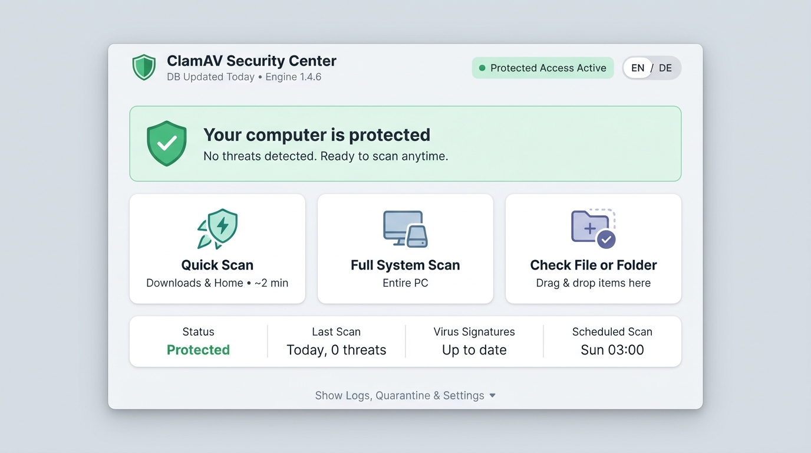
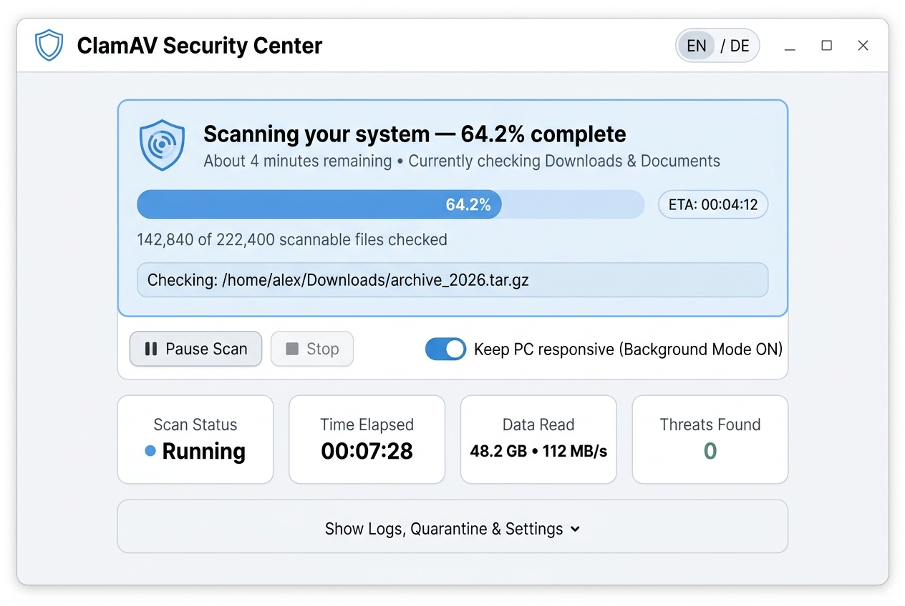
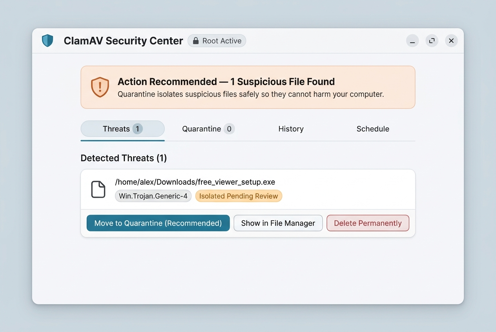
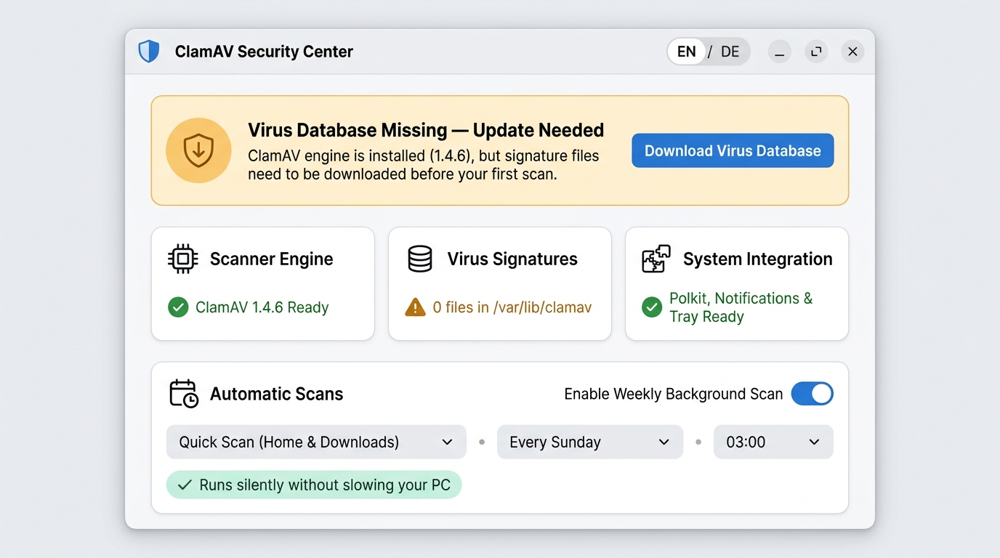

# ClamAV Security Center — End-User UX Mockups

Four cohesive desktop UI concepts designed for **KDE Plasma & GNOME** (`EN / DE`) focusing on clarity, calm status hierarchy, and progressive disclosure of advanced tools.

## 1. Protected Home (Compact Default)
Minimal compact window with a calm green protection hero card, three clear action tiles (*Quick Scan*, *Full System Scan*, *Check File or Folder / Drag & Drop*), a 4-item status summary strip, `EN / DE` pill, and collapsed *Show Logs, Quarantine & Settings* disclosure toggle.

## 2. Active Scan Progress & Background Mode
Blue progress card displaying percentage, human-friendly ETA, file counts, currently scanned path, one-click *Pause* / *Stop*, and an approachable *Keep PC responsive (Background Mode ON)* switch.

## 3. Threat Detected & Guided Resolution
Automatically reveals the *Threats* view with a calm recommendation card, plain file/signature presentation, and a primary *Move to Quarantine (Recommended)* action alongside *Show in File Manager* and *Delete Permanently*.

## 4. System Health Check & Simple Scheduling
Upfront dependency & signature health cards (*Scanner Engine*, *Virus Signatures*, *System Integration*), missing-database CTA (*Download Virus Database*), and a streamlined weekly background scan toggle.

